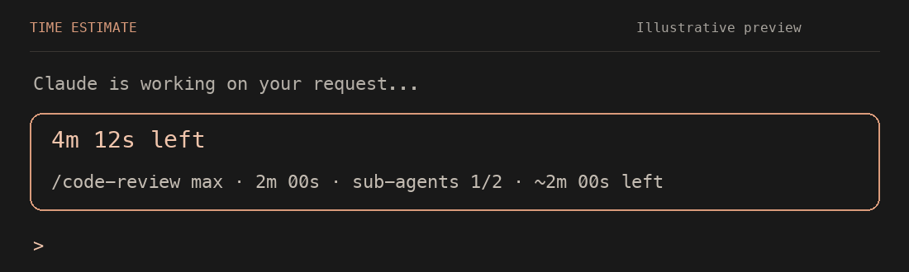

# Time Estimate

Time Estimate adds a countdown above the Claude Code prompt so you can see roughly how much longer a response will take. It uses task progress when available and learns from the duration of previous responses.



*Illustrative preview of the display, with example timings.*

## What you see

```
  ╭──────────────────────╮
  │  ⏳ 4m 12s left       │
  ╰──────────────────────╯
```

| The box shows | Meaning |
| --- | --- |
| `⏳ 4m 12s left` | Estimated time remaining. The main countdown ticks once a second. |
| `⏳ estimating…` | There isn't enough task progress to estimate from, and fewer than 5 finished responses are recorded. |
| `⏳ longer than usual` | There isn't a task-based estimate, and this response has outlasted every recorded response. |

Background agents, including sub-agents, `/code-review` runs and forks, get a line with their elapsed time, sub-agent progress (`sub-agents 2/5`) and an estimate. These lines stay visible while the main session is idle. A `+` after an agent's elapsed time means it was already running when the mod first saw it.

The main countdown disappears when the response ends. The box stays until the background agents finish too.

## Requirements

Use Claude Code **v2.1.287 or later** in an interactive terminal session. This is the version requirement in [Claude Code's mod documentation](https://code.claude.com/docs/en/plugins/mods/overview#turn-mods-on-or-off). Check your installed version with:

```sh
claude --version
```

Mods must be enabled in the session. If the plugin installs but nothing appears, check the active mods in `/plugin` and follow the [mod troubleshooting guide](https://code.claude.com/docs/en/plugins/mods/overview#see-which-mods-a-session-loaded).

## Install

At the prompt of a Claude Code terminal session:

```
/plugin install time-estimate --marketplace TomerBenShimol/claude-time-estimate
```

Confirm that you want to add the marketplace, then install the plugin and choose a scope. User scope enables it across your projects on this computer.

Or from your shell:

```
claude plugin install time-estimate --marketplace TomerBenShimol/claude-time-estimate
```

If a session is already open when you install from the shell, run `/reload-plugins` in that session. Otherwise, the plugin loads when you next start Claude Code. See [Claude Code's installation guidance](https://code.claude.com/docs/en/plugins/mods/overview#install-or-update-a-mod).

## How the estimate works

When Claude uses `TaskCreate`, `TaskUpdate` or `TodoWrite`, the mod counts completed and open tasks. Once a task finishes during the current response, it divides elapsed time by the number completed and multiplies that average by the number still open.

Without usable task progress, it looks at the last 50 finished responses, saved across sessions. It keeps the responses that lasted longer than the current elapsed time, takes their median duration, and subtracts the time already spent. This fallback needs at least 5 recorded responses.

The main countdown holds an end time between updates. It recalculates when the completed-task count or estimate source changes, or when the countdown runs out. If no estimate is available, it shows one of the messages above.

Background agents use completed sub-agents to estimate progress, then fall back to the last 50 recorded runs with the same label. One recorded run is enough for that fallback. Their estimates refresh every second; they don't use the main countdown's fixed end time. Only agents observed from the start contribute to saved history.

## How much to trust it

Treat the countdown as a rough guide. Tasks can differ in size, and an agent may discover more work halfway through a request. A slow command or a long final task can make the estimate too short. Past responses can also be a poor match for the current request, especially after a change in model or workload.

Reaching zero doesn't stop Claude or mean the response is complete. The mod recalculates if it still has an estimate; otherwise it displays a status message. That can make the countdown jump back up.

There is a known task-tracking limitation: reopening a completed task currently leaves it counted as done, which can skew the estimate.

## Develop

From the parent directory of a local clone, start a session with the mod loaded:

```
claude --plugin-dir ./claude-time-estimate
```

Changes Claude makes during a turn reload when the turn ends.

Check and test:

```
claude plugin validate ./claude-time-estimate
claude plugin test ./claude-time-estimate
```

The engine writes API types into `.claude-plugin/types/` when it first loads the mod for development. After that, type-check with:

```
npx tsc -p ./claude-time-estimate --noEmit
```

## Layout

```
claude-time-estimate/
├── .claude-plugin/
│   ├── plugin.json        # mod manifest
│   └── marketplace.json   # lets others install it from this repo
├── hooks/
│   ├── hooks.json         # points the engine at register.tsx
│   ├── register.tsx       # hooks: turn timing, task tracking, the band above the prompt
│   ├── estimate.ts        # estimate, countdown and formatting logic (pure functions)
│   └── agents.ts          # background-agent tracking
├── types/index.d.ts       # the mod's state contract
└── tests/                 # claude plugin test suites
```

## Privacy

The mod saves data in Claude Code's local plugin store:

- Up to 50 finished response durations, in milliseconds.
- Agent labels and up to 50 finished run durations per label. Labels come from an agent's description, name or type, so they may contain details about the work.

It also tracks task counts, task IDs, agent IDs and start times in session state. It doesn't save prompt or response bodies to the plugin store, read project files directly, or make network calls. These statements describe this mod; Claude Code's own data handling is separate.
